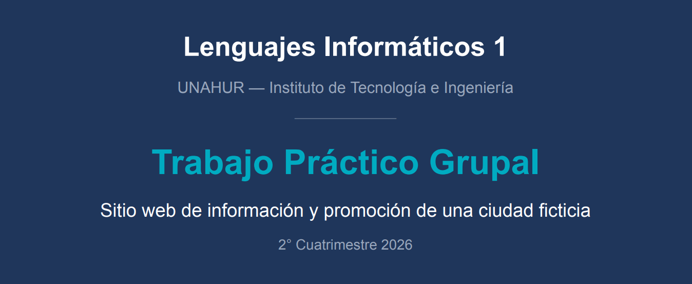

<p align="center">
    
</p>

# Trabajo Práctico Grupal

El siguiente repositorio corresponde a la materia **Lenguajes Informáticos 1** del área de Tecnología e Ingeniería de la **Universidad Nacional de Hurlingham**, la cuál corresponde a poner en práctica todo el contenido visto durante el cuatrimestre. Para ello se realizó dentro de este repositorio de GitHub un sitio web de información y promoción de una ciudad ficticia, cuya maquetación estuvo inicialmente formado por un grupo de 4 personas.

Cada miembro del equipo se ha repartido una porción del sitio web para manejarlo a su semejanza, siguiendo una temática de lugar conocido: **Naboo** es una de las locaciones que tiene relvancia dentro de la saga de ciencia-ficción **Star Wars**. En base a ello, el equipo ha hecho de cada porción de su página HTML un sandbox de pruebas en las que debe conocer cada una de las herramientas aprendidas en clase, combinando esto con el conocimiento que aporta cada uno acerca de la información que enriquece a la ciudad ficticia, a la armonización del contenido y los colores, y a la ordenanza de la estructura que se espera en cada lenguaje.

Tal como se sigue el progreso del contenido en clase, **primero se desarrolla la estructura y el contenido de un lenguaje de marcado de hipertexto como lo es HTML**, en la que se mostrará el contenido esencial basado en el texto y las etiquetas que lo ordenan de forma lineal o en bloque. Luego de incorporarse las etiquetas esenciales del "body" en las que se incluye **main, header, nav, footer, section, article y aside**, se comienza a incorporar un diseño que modifica los colores y tamaño de las cajas y del texto de las cajas del HTML, usando declaraciones colocadas en lenguaje CSS: **otra hoja de código en la que cada porción hará hincapié en una parte del HTML mediante el uso de un selector, cambiando los valores de una propiedad o varias de sus propiedades nativas a un valor que lo haga más visible estéticamente de forma notoria**. Posteriormente se utiliza mejores herramientas para relizar sitios que respondan a distintos dispositivos y a las condiciones de accesibilidad de cada usuario que observe tal sitio web: para ello la relación entre HTML y CSS deja a un lado su impronta totalmente estática para comenzar a ser interactiva dependiendo del tamaño de cada pantalla, de la responsividad que busca el usuario lector, de reducir líneas de código y tiempo de adaptación a herramientas de código prediseñadas conocidos como **frameworks** tal como lo es Bootstrap, y a la adaptación de las cajas en bloque mediante display: flex y display: grid para mejorar la visualización. Finalmente se agregarán funcionalidades interactivas mediante hojas de JavaScript para realizar funciones más puntuales o más complejas.

Cada etapa deberá construirse sobre la anterior, de manera que el proyecto evolucione progresivamente hasta obtener un sitio web completo, navegable, adaptable e interactivo. El objetivo del trabajo no es solamente obtener un sitio terminado, sino también poner en práctica el proceso de desarrollo colaborativo: organizar las tareas, distribuir el trabajo entre los integrantes, utilizar Git y GitHub para registrar los avances y aplicar progresivamente los conceptos trabajados durante la materia.

## Alumnos que conforman el grupo

Estos alumnos han iniciado la coformación del **GRUPO 7 de la Comisión 9** de la materia de **Lenguajes Informáticos 1**, cuya cursada se realiza los jueves de 18 a 22 horas.

 - Lucas García
 - Ludmila Cabral
 - Nicolas Federico Benialgo
 - Emanuel Santiago Alonso

## Calendario de commits obligatorios

| Commit | Fecha de entrega | Etapa general            | Contenido esperado                                                                       |
|--------|------------------|--------------------------|------------------------------------------------------------------------------------------|
| 1      | 13/09/2026       | Estructura básica HTML   | Se espera el index.html + páginas secundarias con HTML semántico completo                |
| 2      | 04/10/2026       | Estilos CSS estático     | Hoja de estilos en cascada vinculada a los HTML. Layout, colores y tipografía aplicados. |
| 3      | 08/11/2026       | Framework CSS dinámico   | Grilla responsiva con Flexbox o display:grid, y componentes de Bootstrap integrados.     |
| 4      | 22/11/2026       | Funciones con JavaScript | Al menos una interacción dinámica funcionando en el sitio.                               |

## Estructura de archivos

El repositorio principal **main** debe quedar estructurada con el siguiente esquema base:

```
mi-ciudad/
├── index.html ← **página inicial desde donde arranca el deployment de GitHub**
├── ciudad.html
├── lugares.html
├── contacto.html
├── css/		← carpeta donde se añade archivos css
│ └── estilos.css ← archivo nuevo del segundo commit (enlaza a index.html y a lugares.html)
│ └── ciudad-style.css ← archivo nuevo del segundo commit (enlaza a ciudad.html)
│ └── contacto-style.css ← archivo nuevo del segundo commit (enlaza a contacto.html)
└── img/		← carpeta donde se añade todas las imágenes
└── js/			← carpeta donde se añade los scripts de JavaScript
└── assets/		← carpeta donde se añade todos los archivos que no son imágenes como tal
└── ...
```

**Nota:** Todos los archivos HTML deben tener un mismo '<header>', un mismo '<footer>' y una misma estructura de la etiqueta '<nav>'.

Por el momento, el uso del branch **beta** fue única y exclusivamente para hacer pruebas del manejo de Git Bash en el escritorio y sus formas de realizar cambios rápidos "de nube a local" y "de local a nube", haciendo uso del pdf "Git_ La Guía Sencilla para Principiantes". 

## Práctica recomendada para iniciar con el uso del sitio Git

Cada uno de los integrantes debe realizar en el momento acordado en conjunto la instalación de la aplicacion GIT a su computadora personal, instalando sin realizar modificaciones a las sugerencias mostradas más allá de apretar "Siguiente" o "Next". Con GIT instalado, usar su variante llamado **Git Bash**, el cuál se abrirá una ventana negra tipo Terminal cuya primer línea dirá los nombres con los que se identifica a su PC personal. **Cada miembro del equipo tendrá que escribir las siguientes líneas de código en Git Bash** ni bien lo hayan instalado:

Primer línea:

```
	git config --global user.name "NombreDeUsuario"
```
Segunda línea:

```
    git config --global user.mail "SuCorreoPersonal"
```

Cabe destacar que dentro de las comillas de "NombreDeUsuario" deben reemplazarlo por el nombre de usuario de su GitHub o más bien por su nombre y apellido personal, y que dentro de las comillas de "SuCorreoPersonal" deben reemplazarlo por un correo electrónico existente que usen actualmente, preferentemente el que usen de acceso a GitHub y recomendable que no sea el correo institucional de alumno, salvo que se aclare lo contrario.
**NOTA: Si estás realizando este paso en una computadora que no es suya sino compartida o pública, coloca el mismo tipeo de arriba sin** `--global`. Exactamente así:

Primer línea:

```
	git config user.name "NombreDeUsuario"
```
Segunda línea:

```
	git config user.mail "SuCorreoPersonal"
```

**Ejemplo de aclaración**:

Primer línea:

```
	git config --global user.name "EstebanSanzo"
```
Segunda línea:

```
	git config --global user.mail "estebansanzo@hotmail.com"
```

 5. Cada alumno debe **clonar el repositorio** del Trabajo Grupal: debes entrar al repositorio en el GitHub, presionar en el botón verde que dice **<> Code** y allí dentro de la pestaña Local verás el apartado llamado **Clone**, el cuál tendrás que copiar al portapapeles el link que aparece en opción HTTPS. Luego, elegirás o crearás una carpeta de tu computadora personal, abrirás esta carpeta, darás click al botón derecho del mouse y presionarás del menú la opción **Open Git Bash Here** para abrir Git Bash y configurar esa carpeta en específico. Si lograste hacer esto, salteate el punto 6 y continuá en el punto 7.
 
 6. Si querés trabajar en la misma Git Bash sin reiniciar la terminal, tendrás que entrar a la carpeta que hayas creado, copiarás la ruta de dirección de esa carpeta en sí (como ejemplo, si eliges la carpeta "YoPracticoGit" colocada en la carpeta Escritorio, tu link se vería algo así: `C:\Users\NOMBREDELACOMPU\Desktop\YoPracticoGit` (en cada dispositivo, el NOMBREDELACOMPU será distinto en el link de carpeta local. Luego, en el Git Bash escribirás `cd` y pegarás el link que copiaste inmediatamente despues de haber escrito `cd`, apretar un espacio, hacer click derecho y seleccionar "Pegar". A continuación presiona ENTER.
 7. En la terminal del Git Bash,  habiendo hecho los pasos anteriores, escribirás el siguiente comando:

	`git init`
        
 8. Posterior a esto, escribirás: 

	`git clone URLCOPIADA`
        
	En el caso de Nicolas Benialgo, por ejemplo, le aparecerá el link de esta forma:

	`git clone https://github.com/NicoBenialgo/TrabajoGrupal-Lenguajes1-UNAHUR.git`
        
	A continuación, presioná ENTER para que todo el contenido del repositorio de GitHub se guarde en tu computadora personal. Desde este momento, tendrás una copia exacta del repositorio de GitHub en tu computadora, e incluso desde ahí mismo podrás realizar ediciones para luego subirlos a GitHub mediante Git.
